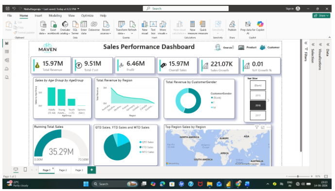
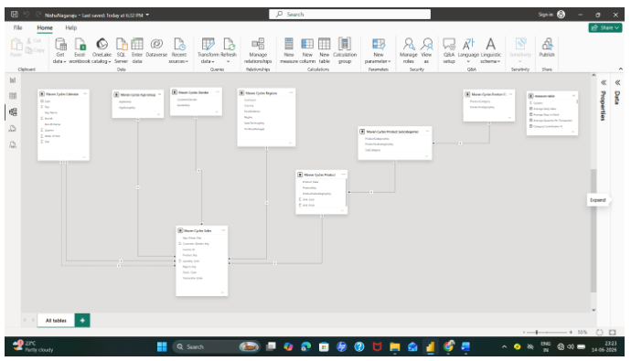

# Maven Cycles Sales Performance Dashboard

**Created by: Nisha Nagaraju**

## Project Overview
This project presents a Maven Cycles sales dashboard created in Microsoft Power BI. The dashboard screenshots show sales performance, product performance, customer insights, and the data model.

## Dashboard Pages

### 1. Sales Performance Dashboard
Provides a high-level view of sales and profit metrics, sales by age group, revenue by region, customer gender, year selection, and regional sales.

### 2. Product Dashboard
Shows product-related metrics, top products by category, product ranking, revenue by region, and product performance.

### 3. Customer Dashboard
Highlights customer-related sales patterns, sales by age group and region, gender-based comparisons, average daily sales, and other customer metrics.

## Data Model
The project PDF also includes a screenshot of the Power BI data model.

## Tools
- Microsoft Power BI

## Project Files
- `Maven-Cycles-Project.pdf` — original project PDF containing dashboard screenshots
- `images/` — dashboard and data-model screenshots used in this README

## Note
This repository currently contains screenshots and documentation. The editable Power BI report file (`.pbix`) and source data are not included in the provided PDF. Add them only if you have permission to share them.
