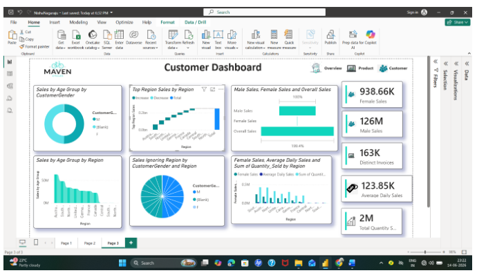
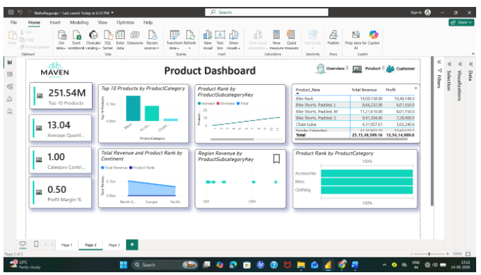

# 🚴 Maven Cycles — Power BI Dashboard

<p align="center">
  <strong>📊 Turning Sales Data into Business Insights</strong>
  <br>
  An interactive Power BI dashboard for sales performance, customer demographics, regional revenue, and product analysis.
</p>

---

## 📌 Project Overview

The **Maven Cycles Power BI Dashboard** is a business intelligence project designed to analyze sales data and uncover meaningful business insights. Using Microsoft Power BI, this project explores sales performance, customer behavior, regional revenue, and product trends through interactive visualizations.

The dashboard helps transform raw data into actionable insights that support data-driven decision-making and business growth.

## 📊 Dashboard Features

### 📈 1. Sales Performance Dashboard
- 📌 Key Performance Indicator (KPI) cards
- 💰 Sales and revenue performance analysis
- 📊 Product and sales trend visualization
- 🎯 Interactive charts for monitoring business performance

### 👥 2. Customer Insights Dashboard
- 🎂 Customer analysis by age group
- 🚻 Customer gender distribution
- 🧑‍🤝‍🧑 Customer demographic analysis
- 💡 Insights into customer segments

### 🌍 3. Regional Analysis
- 🗺️ Revenue analysis by region
- 📊 Comparison of regional sales performance
- 🏆 Identification of high-performing markets
- 📈 Regional business performance insights

### 🚲 4. Product Analysis
- 🛍️ Product performance analysis
- 📊 Comparison of product sales
- 💰 Revenue contribution by products
- 🔎 Insights into product trends

---

## 🖼️ Dashboard Preview

### 📈 Sales Performance Dashboard


### 👥 Customer Insights Dashboard



### 🚲 Product Analysis Dashboard



---

## 🛠️ Tools & Technologies

| Tool | Purpose |
|---|---|
| 📊 Microsoft Power BI | Dashboard development and visualization |
| 📈 Data Visualization | Presenting business insights visually |
| 🔍 Data Analysis | Exploring sales and customer data |
| 💼 Business Intelligence | Supporting data-driven decisions |

## 🎯 Project Objectives

- Analyze overall sales performance and revenue trends.
- Understand customer demographics and segments.
- Compare regional sales performance.
- Evaluate product performance and trends.
- Present business information through interactive dashboards.

## 📁 Project Structure

```text
maven-cycles-dashboard/
│
├── Maven-Cycles-GitHub-Ready/
│   └── Project materials
│
├── sales-dashboard.png
├── customer-dashboard.png
├── product-dashboard.png
└── README.md
```

## 💡 Key Takeaway

This project demonstrates how **Power BI and business analytics** can transform sales data into meaningful visual insights, helping businesses understand customers, evaluate performance, and make informed decisions.

## 👩‍💻 Author

**Nisha Nagaraju**

🎓 Mathematics & Computer Science Graduate | MBA in Marketing & Business Analytics

🔗 [Visit My GitHub Profile](https://github.com/nishanagaraju)

---

⭐ **If you find this project interesting, consider starring the repository!**

🚀 *Exploring data. Discovering insights. Driving business growth.*
